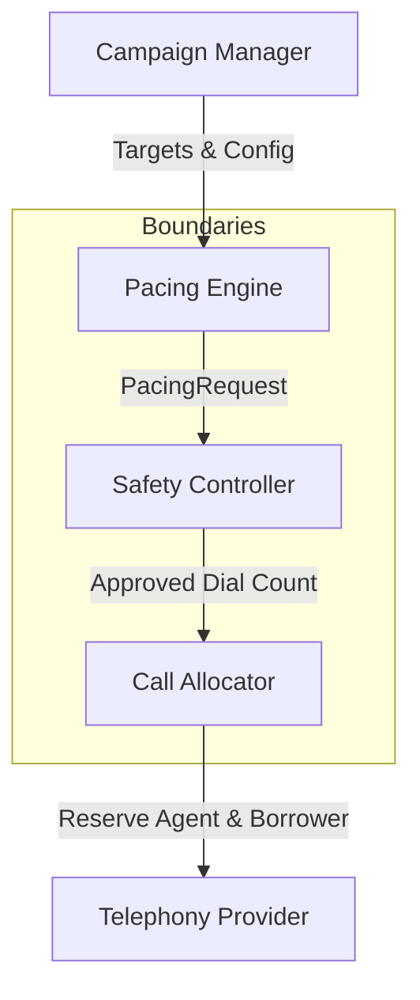
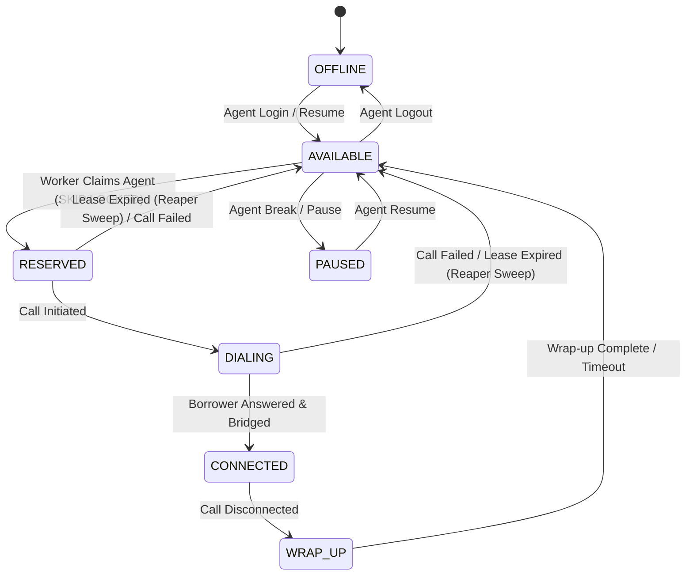
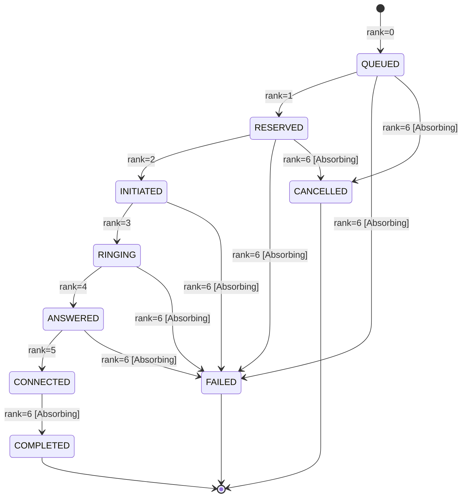

# SmartDialer Architecture Specification

## 1. System Pipeline & Component Flow

The SmartDialer system uses a strict unidirectional execution pipeline. Every dialing iteration evaluates campaign targets, computes optimal pacing, enforces safety limits, acquires agent reservations, and dispatches calls to outbound telephony providers.



### Component Isolation & Strict Decoupling

- **`PacingEngine` Interface**: The Pacing Engine is strictly decoupled from telephony execution. It accepts current system metrics and returns an immutable `PacingRequest` data object. It has **no import path** to provider drivers, database connection pools, or call dispatchers.
- **`SafetyController` Mandatory Guard**: The Safety Controller wraps all allocation decisions. **No feature flag, runtime override, or configuration switch exists anywhere in the codebase to disable or bypass the Safety Controller.** Every dial action must be cleared through its rules.

### Safety Controller Rules (Evaluated in Strict Order)

1. **Absolute Concurrent-Call Cap**: Hard cap on total inflight calls across the system to prevent resource exhaustion regardless of agent count.
2. **Ratio Cap**: Enforces `inflight_calls <= available_agents * 2.0`. Prevents over-dialing during sudden dips in agent availability.
3. **Abandon-Rate Guard**: Monitors 24-hour sliding abandon rate (calls answered by borrower but dropped due to no available agent). If abandon rate exceeds threshold (e.g., 3%), automatically forces pacing into **Progressive Mode** (`desired_dials = available_agents`).
4. **Provider Circuit Breaker**: Evaluates provider failure rates in a 30-second sliding window. If provider failure rate exceeds 50%, circuit breaker trips to `OPEN` and rejects all new dial requests immediately. Transitions to `HALF_OPEN` after 15 seconds to test recovery.
5. **Stale-Metrics Guard**: Checks timestamp of system metric snapshot. If snapshot is older than 5 seconds, drops back to **Progressive Mode** to prevent decisions based on outdated state.

### Pacing Mathematics & Auditability

Pacing calculations run periodically per campaign:

$$\text{answer\_rate} = \text{EWMA}(\text{historical\_answers}, \alpha=0.2) \quad \text{clamped to } [0.05, 0.95]$$

$$\text{expected\_answers\_inflight} = \text{ringing\_calls} \times \text{answer\_rate}$$

$$\text{agents\_free\_soon} = \text{available\_agents} + \text{wrap\_up\_agents} \times P(\text{wrap\_up ends within setup time})$$

$$\text{headroom} = \text{agents\_free\_soon} - \text{expected\_answers\_inflight}$$

$$\text{desired\_dials} = \begin{cases} \left\lceil \frac{\text{headroom}}{\text{answer\_rate}} \right\rceil & \text{if } \text{headroom} > 0 \\ 0 & \text{otherwise} \end{cases}$$

Every pacing evaluation generates a record in the `pacing_decisions` table containing the requested dial count, approved dial count, rule execution reason, and complete metrics `snapshot_json`. Any historical dial count can be audited and explained after the fact.

### Provider Integration & Behaviors

All telephony backends conform to `ProviderProtocol`. Two primary implementations exist:
- **`FastProvider`**: Predictable 100–200ms setup latency, ~2% failure rate, deterministic in-order status webhooks.
- **`FlakyProvider`**: High latency (500–2000ms setup), 15% request timeouts, ~30% duplicate `ANSWERED` events, events out-of-order within a 1-second sliding window (e.g. `COMPLETED` arriving before `ANSWERED`).

---

## 2. Agent State Machine

Agent concurrency is governed by PostgreSQL row locks using `SELECT ... FOR UPDATE SKIP LOCKED` inside transactions. Lease expiration (`reserved_until`) ensures automatic state recovery if a worker dies during call setup.



### State Transitions & Concurrency Rules

- **`OFFLINE`**: Agent not logged in.
- **`AVAILABLE`**: Eligible for reservation.
- **`RESERVED`**: Worker locks agent row via `SELECT ... FOR UPDATE SKIP LOCKED` and sets `reserved_until = now() + 30s`.
- **`DIALING`**: Call request sent to provider; awaiting provider response or webhooks.
- **`CONNECTED`**: Call answered and bridged to agent.
- **`WRAP_UP`**: Call ended; agent completing notes.
- **`PAUSED`**: Agent logged in but temporarily paused.

---

## 3. Call State Machine & Monotonic State Rank

Call state updates enforce strict monotonicity using integer state ranks to handle out-of-order and duplicate provider events idempotently without distributed coordination.



### Monotonic Rank Update Rule

Every status update executes via:
```sql
UPDATE calls
SET state = $new_state,
    state_rank = $new_rank,
    updated_at = now()
WHERE id = $call_id
  AND state_rank < $new_rank;
```

- **Ranks**: `QUEUED=0`, `RESERVED=1`, `INITIATED=2`, `RINGING=3`, `ANSWERED=4`, `CONNECTED=5`, `COMPLETED=6`, `FAILED=6`, `CANCELLED=6`.
- **Absorbing Terminal States**: Once a call reaches rank 6 (`COMPLETED`, `FAILED`, or `CANCELLED`), no update with `state_rank < 6` can ever modify the row because `WHERE state_rank < $new_rank` evaluates to `FALSE`. Out-of-order or duplicate events arriving after a call completes are silently discarded at the database level.
